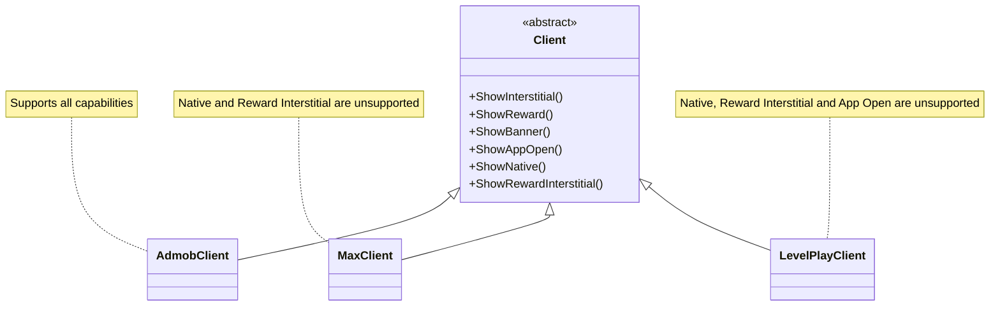
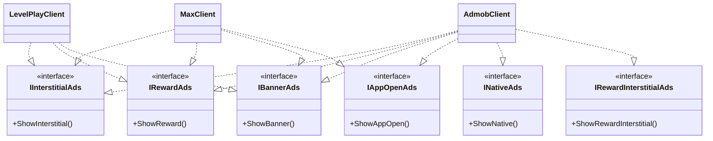

# 🤖 AI Is the Tool. You Are the Boss.

> *AI không thay thế developer chỉ vì AI biết viết code. Nhưng developer không biết làm chủ AI sẽ dần mất lợi thế.*

## 🌱 Mở đầu: AI đang thay đổi công việc của developer

Tôi là một Unity Developer và thường sử dụng các AI agent như Codex và Claude để hỗ trợ phát triển sản phẩm. AI giúp tôi viết code, tìm lỗi và xử lý công việc lặp lại nhanh hơn. Tuy nhiên, sau một thời gian sử dụng, tôi nhận ra tốc độ tạo code không đồng nghĩa với chất lượng sản phẩm.

AI có thể tạo ra feature chạy được, nhưng để feature phù hợp với người dùng, đúng business, có kiến trúc tốt và đủ hiệu năng, người chịu trách nhiệm cuối cùng vẫn là developer. Đây cũng là tinh thần của bài viết [“Tương Lai Của Dev Khi AI Ngày Càng Giỏi”](https://viblo.asia/p/tuong-lai-cua-dev-khi-ai-ngay-cang-gioi-bA468Bn0LKv): nghề developer không biến mất, nhưng cách làm nghề đang thay đổi rất nhanh.

## ❓ AI có thật sự hiểu người dùng không?

AI chỉ hiểu những gì chúng ta cung cấp trong prompt và context. AI không trực tiếp nói chuyện với người dùng, không chịu trách nhiệm về sản phẩm và không cảm nhận được mọi ràng buộc thực tế.

Một câu trả lời nghe hợp lý vẫn có thể sai nghiệp vụ, bỏ sót edge case, không phù hợp với trải nghiệm người dùng hoặc đi ngược mục tiêu kinh doanh. Vì vậy, tôi luôn tự verify thông tin, đọc lại phần code thay đổi và kiểm duyệt kỹ trước khi triển khai.

> **AI có thể trả lời rất tự tin, nhưng sự tự tin không chứng minh câu trả lời là đúng.**

## 👑 AI làm chủ hay bạn làm chủ?

Trong cách tôi tiếp cận AI, tôi là người chủ còn AI là người trợ lý. AI có thể đề xuất phương án, phân tích ưu nhược điểm và triển khai phần code được mô tả rõ, nhưng người quyết định cuối cùng phải là developer.

Một trợ lý giỏi vẫn cần một người chủ biết mình muốn gì. Nếu người dùng không hiểu bài toán, AI sẽ tự lấp đầy khoảng trống bằng các giả định của nó.

> **Trợ lý chỉ mạnh khi người chủ đủ mạnh.**

## 🧠 Dùng AI xong có trở thành “người cụt tay” không?

Khi AI luôn sẵn sàng viết code và giải quyết vấn đề, developer dễ bỏ qua bước tự phân tích. Đến khi hết token, mất context hoặc AI không hoạt động, họ lại không biết bắt đầu từ đâu.

Copy được code chạy thành công không có nghĩa là đã hiểu giải pháp. Nếu không tự rèn luyện problem solving, năng lực sẽ bị bào mòn.

## 🎭 Có nên phân vai cho AI không?

Câu trả lời của tôi là có. Trợ lý cho một chuyên gia vật lý sẽ suy nghĩ khác trợ lý cho một chuyên gia sinh học. Cùng câu hỏi “Vì sao hôm nay trời mưa?”, chuyên gia vật lý sẽ tập trung vào áp suất và ngưng tụ, còn chuyên gia sinh học có thể quan tâm đến tác động lên hệ sinh thái.

Với Unity, tôi có thể phân vai cho AI thành Unity Architect, Gameplay Programmer, Performance Engineer, Code Reviewer hoặc Product Analyst. Mỗi vai trò cần một tiêu chí đánh giá khác nhau.

## 💪 AI có thật sự làm bản thân mạnh lên không?

Không hoàn toàn. AI chỉ giúp chúng ta mạnh lên khi bản thân cũng đang phát triển. Người có nền tảng tốt sẽ đặt câu hỏi chính xác hơn, phát hiện câu trả lời sai nhanh hơn và đánh giá được trade-off.

> **AI khuếch đại năng lực của người dùng, cả năng lực tốt lẫn điểm yếu.**

## ⚙️ Một feature chạy được có đồng nghĩa với feature tốt không?

Tôi từng yêu cầu AI triển khai feature Unity chỉ bằng cách mô tả kết quả mong muốn. Code chạy được, nhưng AI mặc nhiên dùng nhiều method tìm object trong hierarchy như `FindObjectOfType` hoặc các cách truy xuất không phù hợp.

Những cách này có thể ổn trong prototype nhỏ nhưng trở thành vấn đề khi được gọi nhiều lần, scene có nhiều object, hierarchy thay đổi hoặc performance trở nên quan trọng. Từ đó, tôi bắt đầu yêu cầu rõ hơn về dependency injection, pattern, phạm vi thay đổi và tiêu chuẩn performance.

> **Nếu không nói rõ tiêu chuẩn kỹ thuật, AI sẽ tối ưu cho việc “chạy được”.**

## 🧩 Vì sao một controller chung cho nhiều nền tảng quảng cáo dễ trở thành kiến trúc tệ?

Tôi từng triển khai ads mediation cho ba nền tảng:

- **AdMob:** Interstitial Ads, Reward Ads, Banner Ads, App Open Ads, Native Ads, Reward Interstitial Ads.
- **MAX:** Interstitial Ads, Reward Ads, Banner Ads, App Open Ads.
- **LevelPlay:** Interstitial Ads, Reward Ads, Banner Ads.

Ban đầu, AI tạo một abstract class `Client` chứa toàn bộ hành vi mà AdMob hỗ trợ. `AdmobClient`, `MaxClient` và `LevelPlayClient` cùng kế thừa class này.

Thiết kế đó tạo ra vấn đề rõ ràng:

- `MaxClient` phải có method cho Native Ads và Reward Interstitial Ads dù MAX không hỗ trợ.
- `LevelPlayClient` cũng phải có những method không phù hợp với provider.
- Một số method bị để trống hoặc trả về giá trị mặc định.
- Class con phụ thuộc vào hành vi mà nó không cần.
- Thêm một loại quảng cáo mới có thể ảnh hưởng đến mọi client.

Code có thể compile và chạy, nhưng abstraction đã sai từ đầu. Đây là kiểu code nhìn có vẻ “dùng chung được” nhưng tạo ra nhiều phụ thuộc giả và method thừa.

### 🏗️ Kiến trúc trước khi refactor

Sơ đồ dưới đây cho thấy vấn đề: mọi provider đều bị buộc phụ thuộc vào một `Client` lớn, dù mỗi provider chỉ hỗ trợ một phần capability.

Vấn đề nằm ở chỗ `MaxClient` và `LevelPlayClient` vẫn phải mang theo những method mà chúng không thể thực hiện. Các method trống hoặc trả về giá trị mặc định làm cho abstraction trông thống nhất nhưng không còn phản ánh đúng thực tế.

### 🔧 Giải pháp: chia nhỏ interface theo SOLID

Tôi yêu cầu AI refactor theo SOLID, đặc biệt là **Interface Segregation Principle**. Thay vì một abstract class lớn, hệ thống được chia thành:

- `IInterstitialAds`
- `IRewardAds`
- `IBannerAds`
- `IAppOpenAds`
- `INativeAds`
- `IRewardInterstitialAds`

Mỗi client chỉ triển khai interface tương ứng:

- `AdmobClient` triển khai cả sáu interface.
- `MaxClient` triển khai Interstitial, Reward, Banner và App Open Ads.
- `LevelPlayClient` triển khai Interstitial, Reward và Banner Ads.

Kết quả là không còn method trống, giảm coupling, dễ thêm provider và cấu trúc phản ánh đúng khả năng từng nền tảng. Có thể xem phần refactor trong [commit này](https://github.com/VirtueSky/sunflower_2/commit/b347e3ba89c1499f4856505dc55b602ddb70f402).

### ✅ Kiến trúc sau khi refactor theo SOLID

Sau khi áp dụng Interface Segregation Principle, mỗi capability trở thành một interface độc lập. Provider chỉ phụ thuộc vào những interface mà nó thực sự hỗ trợ.

Sơ đồ mới thể hiện đúng capability của từng nền tảng. Khi một hệ thống cần hiển thị Native Ads, nó chỉ phụ thuộc vào `INativeAds`; nó không cần biết toàn bộ `Client` hay các capability khác.

> **Dùng chung code không có nghĩa là ép mọi nền tảng phải dùng chung một interface lớn.**

## 🧼 “Clean code” có phải là một yêu cầu đủ rõ?

“Clean code” có thể chỉ khiến AI format code đẹp, đặt tên dễ đọc và rút ngắn method. Nhưng kiến trúc vẫn có thể khó mở rộng. Vì vậy, cần nêu rõ SOLID, coupling, dependency direction, khả năng test và ranh giới giữa các module.

## ⚠️ AI có thể hiểu sai, nịnh người dùng hoặc tự ý đổi spec

AI có thể bỏ qua một phần yêu cầu, tự thay đổi phạm vi hoặc chọn giải pháp dễ viết hơn. Tôi thường yêu cầu AI nhắc lại spec, liệt kê giả định, nêu điểm chưa rõ, không tự mở rộng phạm vi và báo cáo chính xác các file đã thay đổi.

## 📝 Làm thế nào để giao việc cho AI hiệu quả hơn?

Một yêu cầu tốt nên có bối cảnh, mục tiêu, phạm vi thay đổi, kiến trúc hiện tại, pattern bắt buộc, quy tắc performance, coding convention, edge case và tiêu chí nghiệm thu.

Ví dụ:

> Hãy triển khai feature này trong Unity bằng dependency injection, không dùng API tìm kiếm object trong runtime loop, giữ nguyên public API hiện tại, áp dụng SOLID, trình bày trade-off trước khi sửa code và viết checklist kiểm thử sau khi hoàn thành.

## 🔍 Developer cần kiểm duyệt AI như thế nào?

Hãy đọc diff, kiểm tra dependency, Unity lifecycle, allocation, performance, coroutine, event subscription, null handling, edge case và chạy test trong môi trường gần thực tế. Có thể yêu cầu AI tự review, nhưng review cuối cùng vẫn phải do con người thực hiện.

## 📚 Developer tương lai cần giỏi những gì?

Ngoài viết code, developer cần tư duy giải quyết vấn đề, kiến thức nền tảng, tư duy hệ thống, hiểu business, thiết kế kiến trúc, đánh giá code, viết yêu cầu rõ ràng và phản biện kết quả AI.

AI có thể viết một function nhanh hơn con người, nhưng không tự quyết định được liệu function đó có nên tồn tại hay không. Những quyết định có giá trị cao hơn vẫn cần developer: chọn abstraction, xác định ranh giới module, cân nhắc performance, bảo vệ dữ liệu và ưu tiên trải nghiệm người dùng.

## 🔄 Tương lai sẽ chia developer thành hai nhóm?

Theo tôi, khoảng cách sẽ ngày càng rõ giữa hai nhóm.

### 🚀 Nhóm biết làm việc cùng AI

- Dùng AI để tăng tốc các công việc lặp lại.
- Tập trung vào architecture và problem solving.
- Hiểu sâu business, user flow và hệ thống.
- Biết phân vai cho AI theo từng nhiệm vụ.
- Biết review, phản biện và kiểm soát output.
- Có thể giải thích vì sao một giải pháp được chọn.

AI giúp nhóm này làm được nhiều việc hơn trong cùng một khoảng thời gian, nhưng quyền quyết định vẫn nằm ở developer.

### 🧩 Nhóm chỉ dùng AI ở mức generate code

- Giao yêu cầu rất ngắn và thiếu context.
- Chấp nhận kết quả đầu tiên.
- Không hiểu sâu code được tạo ra.
- Không kiểm tra kiến trúc, performance và edge case.
- Phụ thuộc vào AI để giải quyết cả những vấn đề nền tảng.

Nhóm này có thể tạo ra sản phẩm nhanh trong thời gian đầu, nhưng sẽ khó xử lý các vấn đề phức tạp và khó duy trì chất lượng khi hệ thống lớn lên.

## 🛠️ Một quy trình làm việc với AI mà tôi đang áp dụng

Tôi thường chia công việc thành các bước rõ ràng:

1. **Tự phân tích bài toán:** xác định mục tiêu, ràng buộc và tiêu chí thành công trước khi hỏi AI.
2. **Yêu cầu AI phân tích:** đề nghị AI nhắc lại spec, nêu giả định và đưa ra vài phương án.
3. **Chọn hướng triển khai:** tự đánh giá trade-off về kiến trúc, performance và khả năng bảo trì.
4. **Cho AI thực hiện trong phạm vi nhỏ:** tránh giao một yêu cầu quá lớn và mơ hồ.
5. **Review diff:** kiểm tra từng thay đổi, dependency, lifecycle và edge case.
6. **Chạy kiểm thử thực tế:** kiểm tra trong Unity Editor, thiết bị thật hoặc môi trường gần production.
7. **Đối chiếu lại spec:** bảo đảm AI không tự ý thay đổi phạm vi hoặc hành vi sản phẩm.

Quy trình này giúp AI làm trợ lý thực thi thay vì trở thành người tự quyết định thay cho tôi.

## 🧱 Ai sẽ gặp khó khăn trong thời đại AI?

Đó là người chỉ biết generate code nhưng không hiểu code, không nắm nền tảng, không đọc được kiến trúc, chấp nhận câu trả lời đầu tiên hoặc xem AI là cách để né tránh việc học.

Đặc biệt, các developer intern và junior có thể gặp rủi ro lớn nếu chỉ học cách gọi AI mà bỏ qua kiến thức cốt lõi. Không có nền tảng, họ sẽ không biết câu trả lời nào cần nghi ngờ, phần code nào có thể tạo nợ kỹ thuật hoặc quyết định nào đang làm hỏng kiến trúc.

## ⚖️ Thiếu kiến thức chuyên môn hay thiếu kỹ năng dùng AI đều nguy hiểm

Chỉ giỏi chuyên môn nhưng không biết dùng AI có thể giảm năng suất. Chỉ giỏi dùng AI nhưng thiếu chuyên môn lại không thể kiểm soát chất lượng. Developer cần phát triển song song năng lực chuyên môn và năng lực cộng tác với AI.

Thiếu một trong hai năng lực đều tạo ra vấn đề:

- Thiếu chuyên môn, developer không đủ khả năng kiểm duyệt AI.
- Thiếu kỹ năng dùng AI, developer bỏ lỡ một công cụ tăng tốc rất mạnh.

Vì vậy, việc học AI không nên thay thế việc học Unity, C#, kiến trúc phần mềm hay performance. Hai việc đó cần được thực hiện song song.

## ❓ Bạn đang dùng AI để thay thế mình hay để nâng cấp mình?

Đây là câu hỏi tôi thường tự đặt ra sau mỗi lần sử dụng AI.

Nếu AI làm xong một feature nhưng tôi không hiểu vì sao code được viết như vậy, tôi chưa thật sự tiến bộ. Nếu AI giúp tôi nhìn thấy nhiều phương án, phát hiện một edge case mới, hiểu rõ hơn về trade-off hoặc tiết kiệm thời gian để tập trung vào quyết định quan trọng, khi đó AI mới đang nâng cấp tôi.

## 👑 Kết luận: AI là tool, mình là sếp

AI không chịu trách nhiệm thay developer về sản phẩm. Người quyết định cuối cùng vẫn phải là con người.

Developer chỉ biết viết code sẽ ngày càng khó cạnh tranh. Developer biết giải quyết vấn đề, hiểu sản phẩm và làm chủ AI sẽ có nhiều cơ hội hơn.

> **AI là tool, mình là sếp.**

> **Trợ lý chỉ mạnh khi người chủ đủ mạnh.**

> **Mọi thứ chỉ thật sự tốt lên khi chính chúng ta trở nên giỏi hơn.**

## 😄 Một lời thú nhận ở cuối bài

Mọi người đã đoán chính xác: tôi dùng Codex để viết ra bài này.

Nhưng tôi đã sử dụng trải nghiệm của chính mình, tham khảo thêm những chia sẻ từ các anh em khác, rồi tự review và chỉnh sửa dàn ý trước khi giao cho AI triển khai thành bài viết.

Vì vậy, kết quả cuối cùng mới có thể “sặc mùi” style của tôi như vậy được chứ =))
